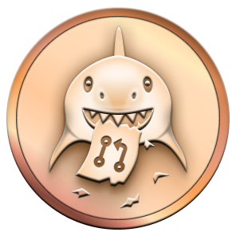
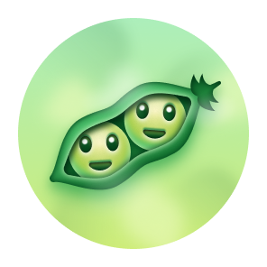

---

## 👋 About Me

Hey, I'm **Aditya**: a builder who loves turning ideas into polished apps. I focus on **macOS/iOS software** and **AI-powered tools** that run locally and feel native.

- 💻 Developer behind **NotchApples** and **Nextora**
- 🔭 Currently building: **NotchApples**, **Nextora** and **Nexus**
- 🌱 Exploring: on-device AI, agents, and developer tooling
- 🏆 **Hackathon Winner**
- ⚡ Fun fact: I like making the Mac notch actually useful

---

## 🛠️ Tech Stack

---

## 🚀 Featured Projects

| Project | What it does | Stack |
|---|---|---|
| [**NotchApples**](https://github.com/AdityaJainDXB/NotchApples) | Turns the notch into a Dynamic Island-style hub: AI, now playing, clipboard, file shelf, AirDrop, live sports scores | Swift |
| [**Nexus**](https://github.com/AdityaJainDXB/Nexus) | Voice-first, on-device AI agent for macOS. Organizes files and runs plain-English automations, offline | Swift |
| [**Token-Trail**](https://github.com/AdityaJainDXB/Token-Trail) | Shows your Claude Code usage as a profile page on the Mac | JavaScript |
| [**Tab-Therapist**](https://github.com/AdityaJainDXB/Tab-Therapist) | Tames tab chaos | JavaScript |
| [**Athenaeum**](https://github.com/AdityaJainDXB/Athenaeum) | Open-source ESP32-S3 e-ink dev board with custom PCB and firmware: downloads free books over Wi-Fi, reads them offline, saves notes, and runs a NASA APOD viewer | C++, ESP32-S3 |

---

## 📊 GitHub Stats

---

## 🏆 GH Achievements

---

## 📫 Let's Connect

